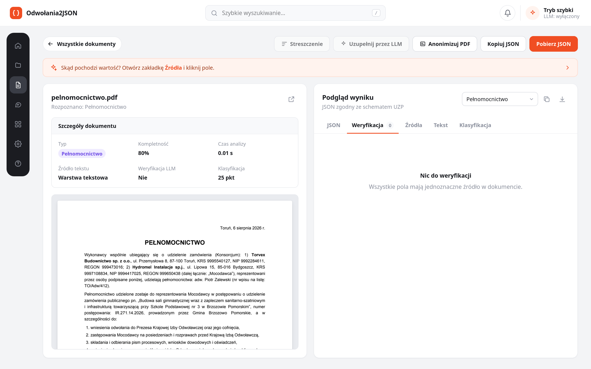
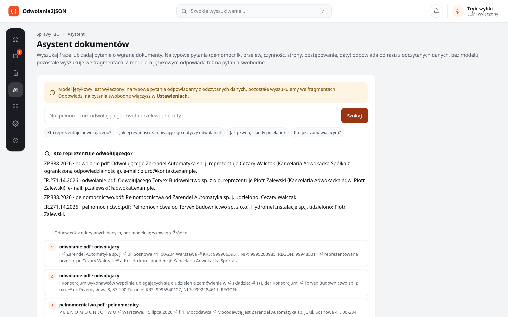
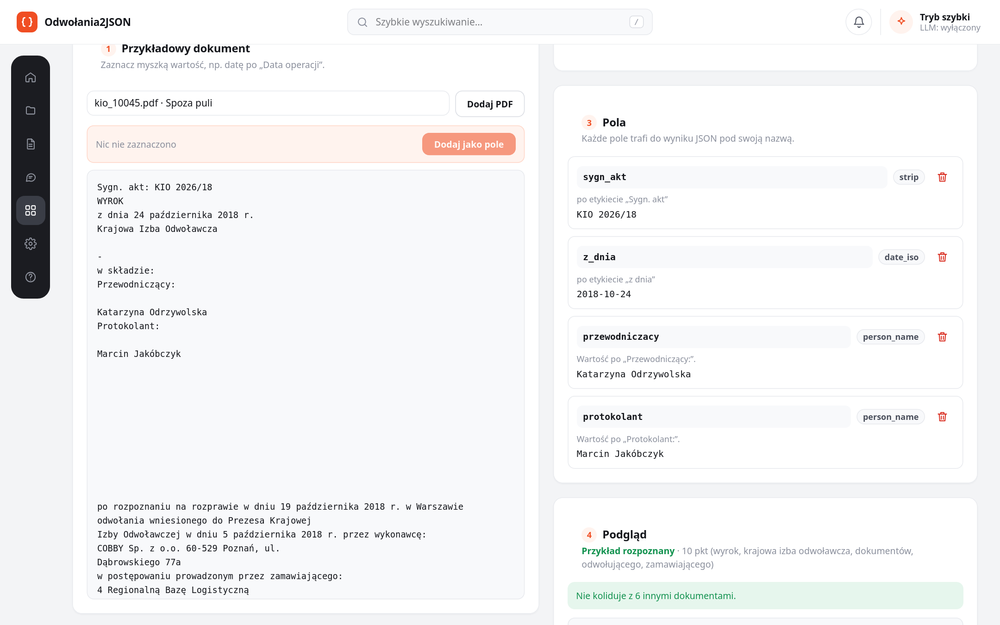
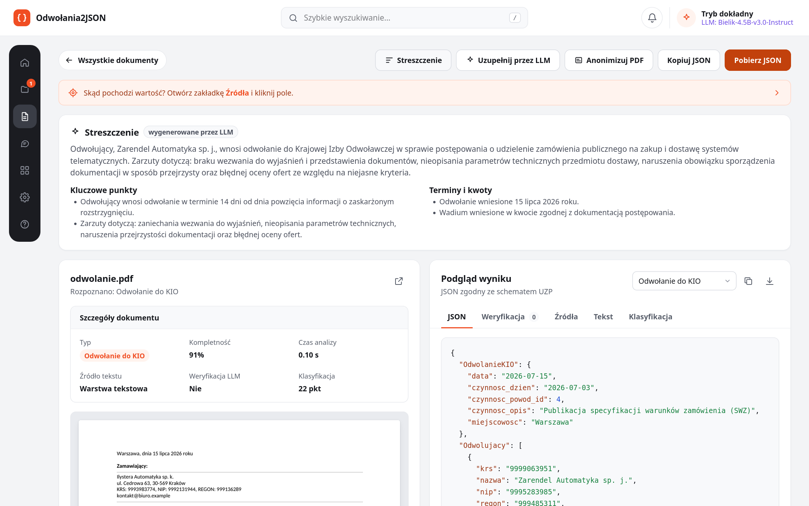
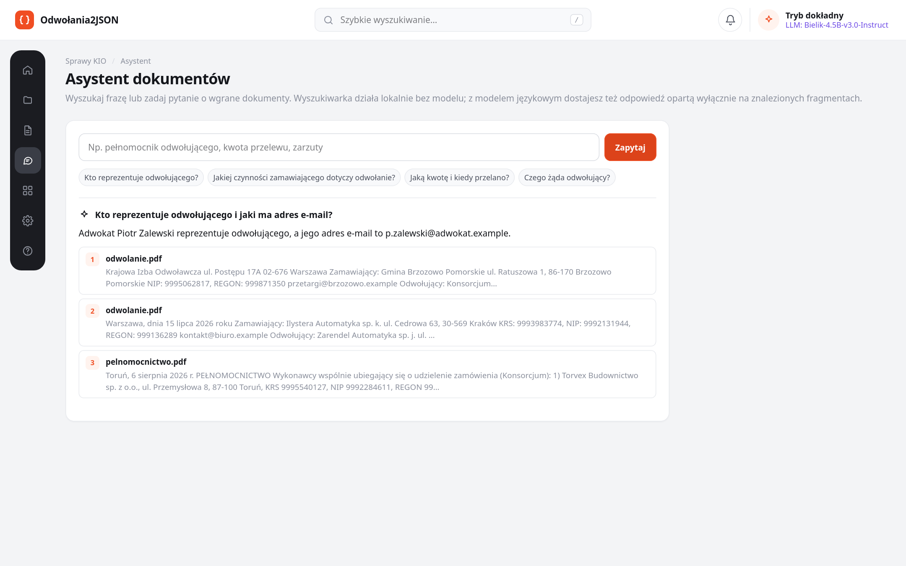
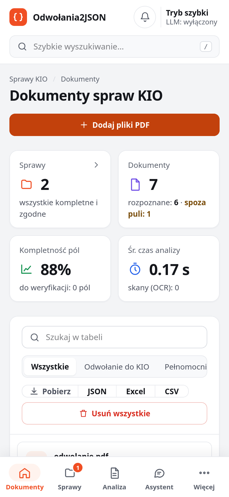
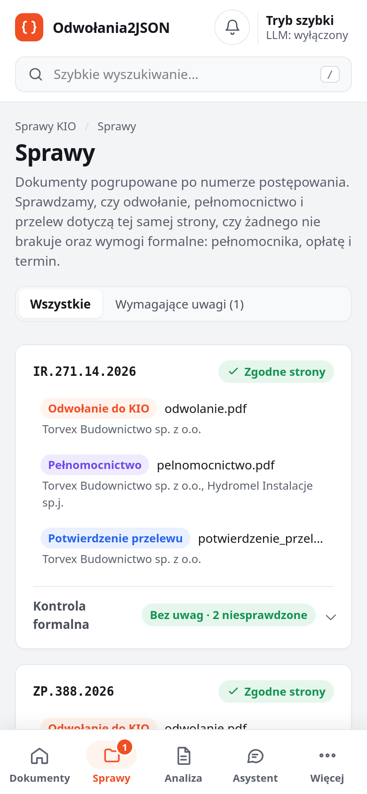

# Odwołania2JSON

Zamiana dokumentów sprawy odwoławczej KIO (PDF) na kanoniczny JSON zgodny ze schematami UZP — wyzwanie **ODWOŁANIA2JSON, HackNation 2026**.

Aplikacja przyjmuje PDF, **rozpoznaje rodzaj dokumentu** (odwołanie, pełnomocnictwo, potwierdzenie przelewu), **wyodrębnia dane** i zapisuje **JSON nazwany jak plik źródłowy**. Każda wartość ma zapisane źródło (fragment i pozycja w tekście), więc ekstrakcja jest w pełni przejrzysta. Nowe typy dokumentów i pola dodaje się w plikach YAML, bez zmian w kodzie.

| | |
|---|---|
| Język | Python 3.13+ |
| Zależności | `requirements.txt`, wyłącznie open source |
| Sprzęt | CPU, bez GPU (OCR RapidOCR na ONNX Runtime, instalowany przez pip) |
| LLM | opcjonalny, otwarty model przez API zgodne z OpenAI |
| Wynik na zbiorze treningowym | **F1 = 1.000** (180 dokumentów, 2032 pola) |
| Wynik na prawdziwych skanach UZP | **F1 = 0.994** (30 skanów z `dane/skany`) |

## Szybki start

**Bez instalowania Pythona (Windows):** pobierz instalator ze strony [praha6248.github.io/odwolania2Json](https://praha6248.github.io/odwolania2Json/) i uruchom *Odwołania2JSON*. W folderze aplikacji jest też `odwolania2json-cli.exe` do pracy wsadowej: `odwolania2json-cli run -i input -o output`.

**Z kodu źródłowego (Python 3.13+):**

```bash
pip install -r requirements.txt
python -m odwolania2json run          # ./input  ->  ./output
python -m odwolania2json serve        # interfejs w przeglądarce: http://127.0.0.1:8000
```

Albo skryptem, który sam tworzy środowisko przy pierwszym uruchomieniu:

```bash
./start.sh            # Linux / macOS
start.bat             # Windows
```

Pliki z `input/` trafiają do `output/` z zachowaniem struktury folderów:

```
input/case1/odwolanie_nr_1.pdf        ->  output/case1/odwolanie_nr_1.json
input/case1/pelnomocnictwo_nr_1.pdf   ->  output/case1/pelnomocnictwo_nr_1.json
input/case1/przelew_nr_1.pdf          ->  output/case1/przelew_nr_1.json
```

Typ dokumentu jest ustalany **z treści**, nie z nazwy pliku. Dokument spoza puli dostaje plik z pustym JSON `{}`.

## Jak to działa

1. **Wgrywasz PDF-y sprawy:** przeciągasz je na stronę albo wrzucasz do folderu `input/`. Nazwy plików nie mają znaczenia.
2. **Tekst:** aplikacja czyta warstwę tekstową PDF. Strony bez tekstu (skany) przechodzą przez OCR na CPU z prostowaniem strony i słownikową korektą polskich słów.
3. **Rozpoznanie typu:** punktacja słów kluczowych, warunki konieczne i kary za cechy innych pism (np. „WYROK”, „Sygn. akt”), wszystko w YAML. Dokument spoza puli dostaje pusty JSON `{}`.
4. **Ekstrakcja:** dla rozpoznanego typu działają reguły z `config/document_types/<typ>.yaml` (sekcje dokumentu, etykiety, wzorce, słowniki, normalizacja dat, kwot, numerów BZP i TED oraz rachunków, zapisywanych tak jak w dokumencie, bez spacji, z kodem kraju (PL lub innym), jeśli dokument go ma). Każde pole zapamiętuje, z którego fragmentu pochodzi.
5. **Wynik:** JSON zgodny ze schematem UZP, nazwany jak plik źródłowy, w tej samej strukturze folderów co wejście.
6. **Tryb dokładny (opcjonalny):** otwarty LLM niezależnie sprawdza pola. Rozbieżności trafiają do weryfikacji, a nie do wyniku. Do tego streszczenia i asystent z cytatami.

### Funkcje dodatkowe (bez modelu językowego)

- **Kontrola formalna sprawy:** dla każdej sprawy aplikacja sprawdza krzyżowo trzy dokumenty: czy odwołujący jest mocodawcą pełnomocnictwa, czy pełnomocnik z odwołania ma pełnomocnictwo, czy tytuł przelewu wskazuje postępowanie, czy opłata poprzedza odwołanie, czy opłata skarbowa pokrywa 17 zł na pełnomocnika i czy odwołanie mieści się w terminie z art. 515 Pzp (5 lub 10 dni, z przesunięciem na dzień roboczy po weekendach i świętach). Reguły są w `config/formal_checks.yaml`.
- **Źródło w PDF:** kliknięcie pola podświetla wartość bezpośrednio na stronie dokumentu.
- **Kreator nowego typu dokumentu:** wgrywasz przykład, zaznaczasz wartości myszką, a kreator proponuje reguły (etykieta, wzorzec, normalizacja), pokazuje wynik na żywo, sprawdza inne wgrane dokumenty i zapisuje zwykły plik YAML.
- **Eksport do Excela i CSV:** zestawienie dokumentów, arkusz na każdy typ z polami JSON w kolumnach i arkusz z kontrolą formalną.
- **Asystent bez modelu:** na typowe pytania (kto reprezentuje odwołującego, jaka kwota i kiedy przelano, czego dotyczy odwołanie, kto jest zamawiającym, numer postępowania, daty, kto podpisał pełnomocnictwo) odpowiada od razu zdaniem złożonym z odczytanych danych, osobno dla każdej sprawy i ze źródłami w dokumencie. Pytania i szablony odpowiedzi są w `config/assistant.yaml`. Pytania o treść pisma (zarzuty, żądania, uzasadnienie) trafiają do lokalnej wyszukiwarki fragmentów (BM25) z podświetleniem słów. Z włączonym LLM ta sama zakładka odpowiada też na pytania swobodne z cytatami.
- **Anonimizacja PDF (na żądanie):** przycisk „Anonimizuj PDF” albo polecenie `anonymize` tworzy osobną kopię z zaczernionymi imionami i nazwiskami osób (także w odmianie), numerami PESEL, e-mailami i telefonami. Strony kopii są obrazami, więc zakrytego tekstu nie da się skopiować. Oryginał i JSON pozostają bez zmian.

### Zrzuty ekranu

| | |
|---|---|
|  **Dokumenty:** strefa przeciągania, liczniki, tabela z typem, stroną, numerem postępowania i kompletnością pól, eksport JSON, Excel i CSV. |  **Analiza dokumentu:** strony PDF obok wyniku JSON. |
|  **Przejrzystość:** kliknięcie pola w zakładce *Źródła* zaznacza wartość na stronie PDF. |  **Weryfikacja:** w trybie dokładnym LLM sprawdza każde pole; tu podał zmyślony NIP i zły powód czynności, więc rozbieżności trafiły do weryfikacji zamiast do wyniku. |
|  **Sprawy:** grupowanie po numerze postępowania, zgodność stron, brakujące dokumenty i kontrola formalna. |  **Asystent bez modelu:** odpowiedź zdaniem z odczytanych danych, osobno dla każdej sprawy, ze źródłami w dokumencie. |
|  **Kreator nowego typu:** zaznaczenie wartości w przykładzie tworzy pole z regułą. |  **Podgląd na żywo:** wartości pól, wynik JSON, rozpoznanie przykładu i innych dokumentów. |
|  **Streszczenie (tryb dokładny):** zarzuty, żądania, terminy i kwoty. |  **Asystent z LLM:** odpowiedź wyłącznie z odnalezionych fragmentów, z klikalnymi źródłami. |
|  **Ustawienia:** tryb szybki lub dokładny, model, klucz, test połączenia. | |

**Filmik (65 s):** [docs/video/odwolania2json-llm-gpu.mp4](docs/video/odwolania2json-llm-gpu.mp4): tryb dokładny z modelem Bielik-4.5B uruchomionym w Ollamie na karcie graficznej (RTX 5060 Ti) w sieci Tailscale. Po prawej widać, jak model ładuje się do pamięci karty (5,7 GB VRAM, 100% na GPU), i czasy zapytań: weryfikacja pól 12,6 s, streszczenie 4,4 s, odpowiedź asystenta 1,8 s.

Na telefonie nawigacja jest na dole ekranu, a tabela zamienia się w listę kart:

<p>


</p>

Widoki mają własne adresy (np. `#/sprawy`, `#/dokument/<id>/weryfikacja`), więc przetrwają odświeżenie strony.

## Użycie

### Polecenia CLI

| Polecenie | Opis |
|---|---|
| `python -m odwolania2json run [-i input] [-o output] [--trace traces]` | tryb wsadowy, opcjonalnie z plikami śladu ekstrakcji |
| `python -m odwolania2json extract plik.pdf [--trace] [--type przelew]` | JSON lub ślad dla jednego pliku |
| `python -m odwolania2json serve [--port 8000]` | interfejs webowy |
| `python -m odwolania2json eval <katalog_z_danymi> [--errors 20] [--strict]` | precyzja, czułość i F1 względem plików referencyjnych |
| `python -m odwolania2json check [input]` | kontrola formalna każdej sprawy (folderu) według `config/formal_checks.yaml` |
| `python -m odwolania2json anonymize [input] [-o output_anonimizacja]` | kopie PDF z zaczernionymi danymi osobowymi |
| `python -m odwolania2json types` | lista typów dokumentów, ekstraktorów i normalizatorów |
| `python -m odwolania2json llm-check` | test połączenia z modelem językowym |

### Interfejs webowy

```bash
python -m odwolania2json serve        # http://127.0.0.1:8000
```

- **Dokumenty:** kafelki KPI, filtr typu, tabela z kompletnością pól i eksportem.
- **Szczegół:** podgląd PDF obok JSON; zakładka *Źródła* pokazuje metodę i fragment tekstu dla każdego pola, a kliknięcie zaznacza wartość na stronie PDF; *Klasyfikacja* pokazuje punktację typów; przycisk *Anonimizuj PDF* pobiera kopię z zaczernionymi danymi osobowymi.
- **Sprawy:** grupowanie, zgodność stron i kontrola formalna każdej sprawy.
- **Asystent:** wyszukiwarka fragmentów bez LLM, a z LLM odpowiedzi z cytatami.
- **Typy dokumentów:** lista typów z YAML i kreator nowego typu.

### Tryby pracy

- **Szybki** (domyślny): same reguły z YAML, bez sieci i bez LLM. Daje maksimum punktów za „moc modelu” w ocenie UZP.
- **Dokładny** (opcjonalny, *Ustawienia*): reguły plus niezależna weryfikacja każdego pola przez otwarty LLM. Rozbieżności trafiają do zakładki *Weryfikacja*, gdzie można poprawić wartość, wybrać wartość LLM albo zatwierdzić puste pole. Do tego **streszczenie dokumentu** i odpowiedzi **Asystenta** na pytania o wszystkie wgrane dokumenty (RAG z BM25 na CPU), wyłącznie z odnalezionych fragmentów i z klikalnymi źródłami.

**Sprawy:** dokumenty są automatycznie grupowane po numerze postępowania (sekcja `case:` w YAML). Interfejs pokazuje zgodność stron między odwołaniem, pełnomocnictwem i przelewem oraz brakujące dokumenty.

**Dokumenty spoza puli** dostają pusty JSON `{}` i komunikat „nie udało się dopasować typu dokumentu” (`unmatched_output` w `settings.yaml`).

### Serwer oceny UZP (Azure, Ubuntu 24.04)

```bash
cd /opt/solution
git clone https://github.com/praha6248/odwolania2Json.git repo
bash repo/deploy/azure/setup.sh      # Python 3.13 (uv), zależności, modele OCR, test na przykładach
sudo bash run.sh                     # komenda z /opt/solution/RUN.md: input/ -> output/
```

`setup.sh` kopiuje do `/opt/solution` pliki `RUN.md` i `run.sh`. Ocena nie potrzebuje sieci, Dockera, GPU ani kluczy API; każdy PDF dostaje plik JSON (dokument spoza puli lub nieczytelny: `{}`), a błąd jednego pliku nie zatrzymuje reszty.

### Docker Compose

```bash
docker compose up -d                              # UI na http://localhost:8000
docker compose --profile batch run --rm batch     # ./input -> ./output
```

### Aplikacja desktopowa i aktualizacje

Na stronie projektu (GitHub Pages) i w zakładce **Releases** są instalator Windows, paczka przenośna Windows (`.zip`) oraz paczka Linux (`.tar.gz`) z sumami SHA-256. W folderze aplikacji są dwa programy: `Odwolania2JSON` otwiera okno (bez konsoli), a `odwolania2json-cli` działa w terminalu z tymi samymi poleceniami co `python -m odwolania2json` (np. `odwolania2json-cli run -i input -o output`).

W Linuksie okno aplikacji korzysta z systemowego GTK 3 i WebKit2GTK. Na Ubuntu 24.04 lub Debianie 12 wymagane pakiety zainstalujesz poleceniem `sudo apt install python3-gi gir1.2-gtk-3.0 gir1.2-webkit2-4.1`. Obsługiwana jest też wersja WebKit2GTK 4.0.

**Aktualizacje małymi łatkami:** każde wydanie zawiera też `Odwolania2JSON-<platforma>.pack` i `.manifest.json`. Zainstalowana aplikacja (dzwonek w prawym górnym rogu) porównuje swoje pliki z manifestem i **pobiera tylko pliki, które się zmieniły**, przez zapytania HTTP Range. Przy zmianie samego kodu to zwykle kilkaset kB. Każdy plik jest weryfikowany SHA-256, podmiana następuje po zamknięciu aplikacji, a foldery `config/`, `input/` i `output/` nie są ruszane. Instalator również nie nadpisuje lokalnej konfiguracji.

## Architektura

```
PDF ──► pdftext ──► classifier ──► engine (+ extractors) ──► [llm] ──► JSON
         │ OCR        YAML: classify   YAML: sections, fields,     opcjonalnie     template
         ▼            (słowa klucz.)   extract chains, normalize   uzupełnia null
      ocr.py
```

| Moduł | Rola |
|---|---|
| `pdftext.py` | tekst z PDF (`pypdf`), czyszczenie Unicode, stopki „Strona X z Y”, akcenty z LaTeX-a; strony bez tekstu idą do OCR |
| `ocr.py` | OCR na CPU: RapidOCR na ONNX (PP-OCRv5 Latin, a strony zniekształcone ponownie PP-OCRv6), Tesseract tylko jako zapas; prostowanie strony, odtwarzanie układu, cache na dysku, poprawki typowych pomyłek |
| `fuzzy_re.py` | wyrażenia regularne niewrażliwe na polskie znaki (OCR często je gubi); wartości są wycinane z oryginalnego tekstu |
| `classifier.py` | punktacja słów kluczowych i wzorców z sekcji `classify` każdego typu, próg w `settings.yaml` |
| `engine.py` | silnik: sekcje dokumentu, łańcuchy ekstraktorów, normalizacja, szablon wyniku, ślad (metoda, fragment, pozycja) |
| `extractors.py` | ekstraktory domenowe (strony postępowania, mocodawcy z podpisującymi, pełnomocnicy, data czynności), rejestrowane po nazwie |
| `normalizers.py` | daty, kwoty, rachunki, KRS/NIP, numery BZP/TED, imiona i nazwiska |
| `llm.py` | opcjonalne uzupełnianie pustych pól przez otwarty model (Ollama, vLLM, llama.cpp lub dostawca w UE) |
| `pipeline.py` | przetwarzanie pliku i drzewa katalogów, zapis JSON i śladów |
| `cases.py`, `formal.py` | grupowanie dokumentów w sprawy i kontrola formalna z `config/formal_checks.yaml` |
| `locate.py` | położenie wartości na stronie PDF do zaznaczenia w podglądzie |
| `wizard.py` | kreator nowego typu: podpowiedzi reguł, podgląd, zapis YAML |
| `export.py`, `assistant.py`, `anonymize.py` | eksport do Excela i CSV, wyszukiwarka BM25 (z LLM odpowiedzi i streszczenia), zaczernianie danych osobowych |
| `evaluate.py` | F1 zgodne z zasadami UZP: zła wartość = FP, brak = FN, długie napisy zaliczane przy ≥ 80% podobieństwa |
| `web/` | FastAPI i jednostronicowy interfejs bez zewnętrznych zasobów |

Pełny opis: [docs/architektura.md](docs/architektura.md).

## Dodanie nowego typu dokumentu

Wystarczy nowy plik `config/document_types/<typ>.yaml`. Przykład i opis wszystkich ekstraktorów: [docs/nowy-typ-dokumentu.md](docs/nowy-typ-dokumentu.md). Zmiany są widoczne po ponownym uruchomieniu albo po kliknięciu *Przeładuj konfigurację* w interfejsie.

## LLM (opcjonalnie)

Wersja zgłoszona do oceny działa **bez LLM**: reguły osiągają F1 1.000 na zbiorze treningowym UZP i 0.994 na skanach UZP, nie potrzebują sieci, GPU ani klucza API i nie generują kosztów. Według punktacji UZP rozwiązanie bez LLM dostaje maksimum punktów za model; opcjonalny Bielik-4.5B mieści się w progu „≤ 8B = 20 pkt”, a OCR działa lokalnie, więc nie wchodzi do średniej parametrów. LLM jest **opcjonalny i domyślnie wyłączony**; służy do funkcji dodatkowych (tryb dokładny, streszczenia, asystent RAG). Włącza się go w interfejsie (*Ustawienia*: przełącznik, adres, model, klucz i przycisk „Testuj połączenie”), dla pojedynczego dokumentu przyciskiem *Uzupełnij przez LLM*, w CLI flagą `--llm` albo zmiennymi środowiskowymi (wzór w `.env.example`):

```bash
O2J_LLM_ENABLED=true
O2J_LLM_URL=http://localhost:11434/v1        # Ollama / vLLM / llama.cpp / dostawca w UE
O2J_LLM_MODEL=hf.co/speakleash/Bielik-4.5B-v3.0-Instruct-GGUF:Q8_0
O2J_LLM_API_KEY=...
```

Model uzupełnia tylko pola wskazane w sekcji `llm.fields` danego typu, które reguły zostawiły puste. Takie pola są oznaczone w śladzie jako `source: llm`. Połączenie sprawdzisz poleceniem `python -m odwolania2json llm-check`. Konfiguracja Ollamy na własnym komputerze i wybór dostawcy w UE: [docs/llm.md](docs/llm.md).

## Jakość

```bash
python -m odwolania2json eval <katalog dane/ z repozytorium UZP>
```

| Zbiór | Wynik |
|---|---|
| 60 zestawów treningowych UZP (180 dokumentów, 2032 pola) | F1 **1.000** |
| 30 prawdziwych skanów UZP (`dane/skany`: odwołania, pełnomocnictwa, potwierdzenia przelewu) | F1 **0.994** (306 trafień, 3 błędne, 1 brak) |
| 150 nowych syntetycznych spraw z haczykami (`tools/generate_testset.py --seed 4242`), tryb ścisły `--strict` | F1 **1.000** |
| 9 prawdziwych odwołań z internetu, wartości sprawdzone ręcznie (`tools/real_world_test.py`) | 99/99 ([raport](docs/testy-na-danych-rzeczywistych.md)) |
| dokumenty spoza puli: 12 negatywnych UZP, 1032 orzeczenia KIO, 28 innych pism z internetu | 100% odrzuconych (pusty JSON `{}`) |
| symulowane skany, poziom średni: 150 DPI, obrót do 1,5°, szum, JPEG 55 (`tools/simulate_scans.py`) | F1 0.971 |
| symulowane skany, poziom trudny: 120 DPI, obrót do 3°, wyblakły toner, JPEG 30 | F1 0.860 |

Skany przechodzą przez OCR na CPU: RapidOCR z modelem PP-OCRv5 dla alfabetu łacińskiego, a strona, na której mniej niż 80% słów to polskie słowa ze słownika, jest czytana ponownie modelem PP-OCRv6 (wielojęzyczny, z polskim) i wygrywa lepsza wersja (`ocr.rapidocr_model: auto` w `settings.yaml`). Do tego prostowanie strony, odtwarzanie układu kolumn i etykiet, poprawki typowych pomyłek OCR (np. „q” zamiast „ą” na końcu słowa, „o” zamiast zera w dacie, brakujący cudzysłów otwierający, nazwa miesiąca z jedną złą literą) i słownikowa korekta polskich słów. Najsłabszy jest poziom „trudny”: przy 120 DPI i mocnej kompresji część drobnego, bladego druku jest nieczytelna także dla człowieka.

**Czas przetwarzania** na zwykłym CPU: PDF z warstwą tekstową 0,01–0,2 s na dokument. Na serwerze oceny UZP (2 vCPU) zestaw 51 PDF-ów, w tym 30 skanów UZP i 12 dokumentów spoza puli, przetwarza się w 7 min 20 s (dwa procesy, `run --workers 0`), z F1 0.998. Cały zbiór UZP (226 PDF-ów: sprawy, skany i dokumenty negatywne) zajmuje 7 min 26 s przy 0,85 GB RAM, więc limit 45 minut na 150 plików ma duży zapas. Każdy JSON jest zapisywany zaraz po przetworzeniu swojego PDF-a, a `--time-limit 40` w komendzie oceny czyta pliki rozpoczęte po 40. minucie bez OCR. Skan: kilka sekund na stronę (na laptopie obciążonym innymi programami do ok. 15 s); strona zniekształcona jest czytana drugi raz. OCR obejmuje najwyżej 4 pierwsze strony bez warstwy tekstowej (`ocr.max_pages`), bo tam są wszystkie potrzebne dane, a wynik OCR trafia do pamięci podręcznej, więc ponowne przetworzenie tego samego pliku jest natychmiastowe.

Same modele LLM bez reguł (`tools/eval_llm.py`, 16 spraw): Bielik-4.5B F1 0.78, Qwen3-1.7B 0.64, Qwen3-0.6B 0.53, Bielik-1.5B 0.47, Qwen2.5-1.5B 0.37 (szczegóły i opis wykorzystanego LLM: [docs/llm.md](docs/llm.md)). Dlatego LLM służy tylko do weryfikacji i funkcji dodatkowych, a wynik JSON pochodzi z reguł.

## Rozwój

```bash
pip install -r requirements-dev.txt
python -m pytest -q
python -m pyflakes odwolania2json tools packaging tests
```

Narzędzia do własnych testów jakości (`tools/`):

| Skrypt | Do czego |
|---|---|
| `generate_testset.py` | syntetyczne sprawy z plikami wzorcowymi i trudnymi przypadkami (konsorcja, wielu zamawiających, odmiana nazwisk, różne formaty dat i kwot) oraz dokumenty-pułapki spoza puli |
| `simulate_scans.py` | zamiana spraw z plikami wzorcowymi w skany o trzech poziomach trudności, do oceny OCR przez `eval` |
| `real_world_test.py` | pobranie publicznych odwołań i dokumentów-pułapek z internetu (z poszanowaniem robots.txt), przetworzenie przez CLI i API, porównanie z wartościami sprawdzonymi ręcznie |
| `scrape_corpus.py` | pobieranie orzeczeń KIO i innych pism do testów odrzucania |
| `eval_llm.py` | porównanie samych modeli LLM (bez reguł) |

Workflowy GitHub Actions:
- `checks`: testy i test wsadowy przy każdym pushu;
- `bump version`: wersja zawsze o jeden patch powyżej ostatniego wydania;
- `release`: budowa paczek PyInstaller i instalatora Inno Setup, publikacja wydania oraz obrazu Docker w GHCR;
- `download page`: strona z pobieraniem na GitHub Pages.

## Licencja

Apache License 2.0, pełny tekst w pliku [LICENSE](LICENSE).

Wykorzystane komponenty zewnętrzne (wszystkie open source):

| Komponent | Zastosowanie | Licencja |
|---|---|---|
| pypdf, pypdfium2 (PDFium) | tekst i renderowanie stron PDF, położenie wartości na stronie | BSD-3-Clause, Apache-2.0 |
| RapidOCR z modelami PP-OCRv5 i PP-OCRv6 (PaddleOCR) | OCR skanów na CPU | Apache-2.0 |
| ONNX Runtime | uruchamianie modeli OCR | MIT |
| wordfreq, Morfeusz 2 | słownik i odmiana polskich słów | Apache-2.0 (dane CC BY-SA 4.0), BSD-2-Clause |
| FastAPI, Uvicorn, python-multipart | interfejs webowy | MIT, BSD-3-Clause, Apache-2.0 |
| PyYAML, NumPy, Pillow, openpyxl | konfiguracja, obrazy, eksport do Excela | MIT, BSD-3-Clause, MIT-CMU, MIT |
| Tesseract (zapasowy OCR, jeśli jest zainstalowany) | OCR | Apache-2.0 |
| Bielik-4.5B-v3.0-Instruct, Ollama (opcjonalnie) | tryb dokładny z LLM | Apache-2.0, MIT |
| PyInstaller, Inno Setup | budowanie paczek i instalatora | GPL-2.0 z wyjątkiem dla budowanych programów, licencja Inno Setup |

